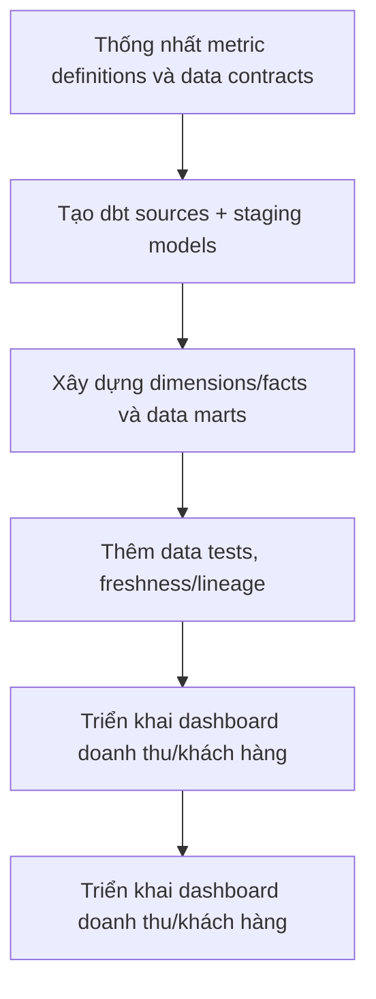

# Analytics Engineering & BI

**Module 02 — Cloud Analytics Engineering · Project 06 | OmniCommerce Data Platform**

> Xây dựng transformation layer và dashboard cho OmniCommerce, đảm bảo KPI có định nghĩa, lineage và test.

**Trạng thái: Planned — repository định hướng học tập, CHƯA có implementation.** README này trình bày phạm vi dự kiến, không phải tuyên bố hệ thống đã chạy hoặc đạt benchmark.

## 1. Tổng quan và bài toán nghiệp vụ

OmniCommerce là doanh nghiệp thương mại điện tử giả lập dùng xuyên suốt lộ trình Data Engineering. **Bài toán của Project 06:** Các phòng ban tính revenue/retention theo các công thức khác nhau; thiếu mô hình dữ liệu dùng lại được và không biết dashboard lấy dữ liệu từ đâu.

Dự án được thiết kế để chứng minh không chỉ khả năng dùng công cụ mà cả cách phân tích yêu cầu, thiết kế giải pháp, nhận diện tình huống lỗi, kiểm thử và vận hành có thể giải thích được.

## 2. Mục tiêu và giá trị mang lại

- **Business goal:** Xây dựng transformation layer và dashboard cho OmniCommerce, đảm bảo KPI có định nghĩa, lineage và test.
- **Engineering goal:** Hiểu kiến thức nền tảng, nắm trade-offs, viết implementation có test và tài liệu thiết kế.
- **Portfolio goal:** Có demo tái lập được, requirements, architecture/ADR, test evidence và hướng dẫn vận hành.
- **Phạm vi nguồn dữ liệu:** BigQuery raw/curated tables từ Project 05.

**Kết quả dự kiến:** một dự án có thể trả lời rõ *tại sao xây dựng*, *đầu vào/đầu ra là gì*, *hành vi khi lỗi*, *cách kiểm tra* và *giới hạn hệ thống*.

## 3. Technology Stack (dự kiến)

| Nhóm | Công nghệ / chủ đề | Vai trò |
|---|---|---|
| Core tools | dbt Core, BigQuery, SQL, YAML, GitHub Actions (sau), Looker Studio | Xây dựng các thành phần chính theo từng milestone |
| Engineering knowledge | Source/staging/intermediate/marts, model dependencies, dbt tests, snapshots, incremental models, exposures, semantic definitions và BI dashboard | Kiến thức phải hiểu và có thực hành trước khi đánh dấu hoàn thành |
| Documentation | Markdown, Mermaid, ADR, runbook | Ghi lại kiến trúc và quyết định |
| Verification | Tests, fixtures, failure injection, benchmark khi phù hợp | Chứng minh hành vi thay vì chỉ mô tả |

**Nguyên tắc:** Công nghệ có thể thay đổi khi phân tích trade-offs. Không cài đặt tất cả cùng lúc; chỉ thêm công cụ khi có bài toán yêu cầu.

## 4. Kiến trúc mục tiêu — Conceptual Workflow


definition: mô tả một luồng logic dự kiến, chưa phải sơ đồ của hệ thống đang chạy.



**Điểm cần xác định trong System Design:** dữ liệu đầu vào, hợp đồng dữ liệu/schema, nơi lưu trạng thái, boundary transaction/idempotency, lỗi tạm thời vs lỗi vĩnh viễn, monitoring và các giới hạn mở rộng.

## 5. Functional Requirements

| ID | Requirement | Trạng thái |
|---|---|---|
| FR-01 | dbt models có source lineage | Chưa triển khai |
| FR-02 | Tests unique/not_null/relationships/business rules | Chưa triển khai |
| FR-03 | Incremental model hoặc snapshot theo bài toán | Chưa triển khai |
| FR-04 | Dashboard phục vụ câu hỏi nghiệp vụ | Chưa triển khai |
| FR-05 | Documentation và KPI dictionary | Chưa triển khai |
| FR-06 | Query reconciliation | Chưa triển khai |

Các yêu cầu sẽ được tách thành tickets nhỏ, mỗi ticket có inputs/outputs, các trường hợp lỗi và acceptance tests trước khi implementation.

## 6. Non-functional Requirements

- **NFR-01:** KPI nhất quán giữa models và dashboard.
- **NFR-02:** Fail-fast khi data quality không đạt.
- **NFR-03:** Có cơ chế kiểm soát chi phí warehouse.
- **NFR-04:** SQL transformations versioned và reviewable.


Không tự đặt ra kết quả như “exactly-once”, “99.9% uptime”, “tối ưu 30% chi phí” hoặc “xử lý 1 triệu events/s” trước khi có phạm vi và phép đo xác thực.

## 7. Engineering Challenges & Trade-offs

- **Challenge 01:** Revenue định nghĩa ở cấp order hay order_item. Cần document các phương án, điều kiện áp dụng và test kiểm chứng.
- **Challenge 02:** SCD Type 2 và historical truth. Cần document các phương án, điều kiện áp dụng và test kiểm chứng.
- **Challenge 03:** Incremental backfill bị sai. Cần document các phương án, điều kiện áp dụng và test kiểm chứng.
- **Challenge 04:** Dashboard nhìn đúng nhưng số liệu sai. Cần document các phương án, điều kiện áp dụng và test kiểm chứng.


## 8. Milestones / Learning Roadmap

| Milestone | Nội dung và deliverable dự kiến | Tiến độ |
|---|---|---|
| M1 | dbt foundations và modeling layers | Chưa bắt đầu |
| M2 | Tests, lineage và documentation | Chưa bắt đầu |
| M3 | Incremental/snapshot strategy | Chưa bắt đầu |
| M4 | Looker dashboard + KPI validation | Chưa bắt đầu |
| M5 | Quality report và demo | Chưa bắt đầu |

**Cách học mỗi checkpoint:** Problem → Concept → Tiny Example → Feynman (≥ 8/10) → Implementation → Tests/Evidence → Commit Git. Học từng khái niệm, không học dồn nhiều kỹ thuật trong một lần.

## 9. Acceptance Criteria — Definition of Done

- [ ] **AC-01:** dbt build/test thành công trên dataset xác định.
- [ ] **AC-02:** Dashboard có ít nhất 4–6 KPI rõ công thức.
- [ ] **AC-03:** Đối soát KPI với SQL gốc.
- [ ] **AC-04:** Có lineage và giải thích business assumptions.

- [ ] Có README phản ánh đúng khả năng hiện tại, không nhầm planned với implemented.
- [ ] Có tài liệu kiến thức, architecture/ADR và runbook tương ứng khi cần.
- [ ] Test evidence ghi rõ environment, input, command, expected/actual và hạn chế.

**Hoàn thành:** Chỉ chuyển milestone/requirement sang Completed khi có code chạy thực tế và evidence phù hợp, không phải khi mới có tài liệu mô tả.

## 10. Repository Structure (định hướng, chưa tạo)

```text
dbt-analytics-engineering-bi/
├── README.md                 # Hiện tại chỉ có file này
├── docs/                     # Tạo khi có bài học/requirements/ADR
│   ├── 01-knowledge/
│   ├── 02-design/
│   ├── 03-decisions/
│   ├── 04-operations/
│   └── 05-evidence/
├── src/ hoặc scripts/         # Tạo khi bắt đầu code
├── tests/                    # Tạo cùng implementation
└── config/                   # Tạo khi cần môi trường
```

**Lưu ý:** Không tạo thư mục trống chỉ để trông như dự án đã triển khai. Không commit credentials, PII thật, dumps hoặc runtime data nhạy cảm.

## 11. Current Progress & Next Steps

| Nội dung | Trạng thái |
|---|---|
| Business problem, goals, technology scope, draft requirements | Planned trong README |
| Source code / working pipeline | Chưa triển khai |
| Unit / integration / failure tests | Chưa triển khai |
| Benchmarks và kiểm thử vận hành | Chưa triển khai |

**Bước đầu tiên khi bắt đầu Project 06:** Xác minh lại business scenario và requirements, học khái niệm nền tảng đầu tiên, sau đó tạo ticket nhỏ có acceptance criteria. AI Agent chỉ được giao implementation sau khi đã đủ rõ đầu vào, đầu ra, edge cases và cách review.

## 12. Liên kết trong lộ trình

- **Module:** 02 — Cloud Analytics Engineering.
- **Project:** 06/11.

